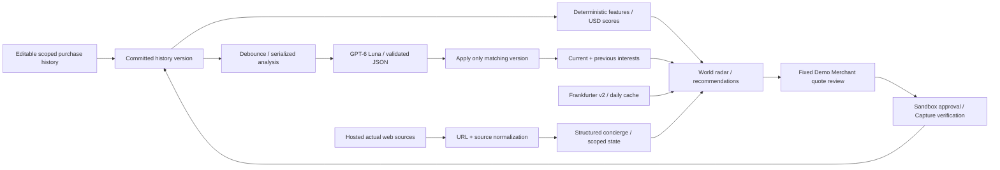

# Commerce Radar — AI Shopping Strategy Engine

**Know What to Buy. Know Where to Buy.**

What you love. Where your dollar goes further.

## Quick Start for Hackathon Judges

Install Docker Desktop with **Linux containers** on Windows/macOS, or Docker Engine
on Linux, and **Docker Compose 2.30+**. Leave TCP port **5173** free.

```bash
git clone https://github.com/Tetsuya-Uchimura/commerce-radar-global.git
cd commerce-radar-global
docker compose up --build -d
docker compose ps
```

Open **http://localhost:5173** (use `localhost`, consistently). No `.env`, API keys,
local Python, Node.js or npm installation is needed for this Docker quick start.
The first build downloads official base images and locked dependencies; download
time depends on the network. Wait for both services to become healthy.

Without keys, judges can select a persona, inspect synthetic history, use the map,
deterministic strategy/statistical explanations, labelled **Demo Products**, saved
historical FX demonstrations and **Simulation · no PayPal API** checkout. Current
daily FX needs Frankfurter connectivity. Missing FX stays missing or explicitly
historical; no current rate is invented. OpenAI analysis and Channel3 automatic
real-product discovery each need their own optional server-side key. Genuine
PayPal Sandbox checkout needs only Sandbox REST app credentials and explicit
buyer approval; it does not require OpenAI or Channel3. **Live is unsupported.**

### 5-Minute Product Walkthrough

1. Open the home page and select **Coffee Enthusiast**.
2. Read **Your AI Shopping Strategy** and its evidence/limitations.
3. Explore **FX Advantage Map**. In the expanded currency controls, a saved
   **Historical Demonstration Scenario** is available when current FX is missing.
4. Change **Shopping priority** between Overseas, US First and Compare. These
   are manual search-priority overrides, not three automatic AI conclusions.
5. Inspect product evidence. With no Channel3 key, the automatic catalog is
   fictional **Demo Products**; dated curated official listings can be inspected
   separately. Origin, link access and purchase costs can remain unknown.
6. Open **AI Concierge**. With no OpenAI key, explanations use labelled fallback
   behavior. Do not interpret it as a fresh OpenAI analysis.
7. Optionally open a fictional Demo Merchant product, select **Review checkout
   conditions**, keep **Simulate · no PayPal API**, and confirm a simulated purchase.
   External real listings use their own merchant checkout.

```bash
docker compose config --quiet
docker compose stop
docker compose start
# Or remove containers/network, preserving the named SQLite volume:
docker compose down
docker compose up -d
```

The backend is internal; Nginx serves the production build and `/api` on the same
origin. A separate named volume holds Docker-only data. Rebuilding or `down`
preserves that volume. Backend restarts invalidate in-memory sessions: reload or
reselect the persona. Never delete a volume to resolve a login issue.

For optional keys, safely create **`.env.docker.local`** from `docker/env.example`;
do not copy or overwrite the developer `.env`. Values are injected into the backend
at runtime and never supplied to the frontend build. Key presence is not proof of
valid authentication. See the commands and privacy notes in
[Docker quick start and troubleshooting](docs/docker-quickstart.md) and
[PayPal Sandbox setup](docs/paypal-sandbox-setup.md).

Docker verification and limitations are recorded in
[Docker judge verification](docs/docker-verification.md). Existing Windows local
development commands remain below.

A map-first shopping concierge for a **United States consumer**, using **USD budgets,
USD estimated totals, and United States delivery**. It connects:

**Editable history → OpenAI interests + daily currency opportunities → FX-aware search
→ observed listing currency/price → explainable rankings + world map → concierge
→ external store or explicitly approved Demo Merchant Sandbox checkout.**


The Strategy Engine is integrated into `main` (`a7fb8a0`). The repository is **Public** for hackathon submission. See [final submission checks](docs/final-submission-check.md) for final-polish verification, integration history and merchant approval instructions. Earlier dated verification records remain historical.

## Shopping strategy (current product concept)

Commerce Radar advises where to **explore shopping**, at home or abroad, using personal interests, daily FX evidence and actual shopping sources. It does not always recommend buying overseas.

- **Explore Overseas:** a relevant, fresh foreign-currency listing has both a potentially meaningful purchasing-power movement and a meaningful hypothetical USD difference.
- **US Stores First:** usable FX evidence provides no compelling foreign-currency advantage. This is search priority, not proof that US stores are cheaper. A specific US-site recommendation requires explicit US storefront-market evidence; USD prices and domain names do not qualify.
- **Compare Both:** FX is mixed, marginal, missing, or relevant price evidence is insufficient. This is a normal result, not an error.

The home-page **Your AI Shopping Strategy** card appears from cache-only deterministic Python output, without waiting for external services. It shows the primary interest, strategy, reference period, evidence status, actual source links/access conditions, and working product/chart/comparison/concierge actions. OpenAI can enrich the explanation asynchronously in two or three short sentences; unavailability leaves the Python explanation intact. The user can choose domestic, overseas or comparison search priority without being blocked by the automatic assessment. Preferences are per persona in the existing chat state and Clear Chat resets them.

Decision thresholds are configurable: ±0.5% provides no compelling FX reason to prioritize overseas; **above 1% plus at least USD 1 of hypothetical listing-price difference**, interest at least 40/100, and fresh verified listing/FX evidence are required for a meaningful shopping opportunity. These are product-design defaults, not universal economic thresholds. `STRATEGY_NEUTRAL_PERCENT`, `STRATEGY_MEANINGFUL_PERCENT`, `STRATEGY_MINIMUM_DIFFERENCE_USD` and `STRATEGY_MINIMUM_INTEREST` control them. Mathematics still records tiny positive/negative FX correctly; marginal items stay in Personal Discovery rather than the strong FX-find section.

Display labels preserve the mathematical ±0.01% classification: positive movements above 0.01% and up to the meaningful percentage threshold read **Slight FX Improvement**; negative movements below −0.01% read **Unfavorable FX Trend**; the remaining band reads **Neutral FX Trend**. A larger positive currency movement alone reads **Favorable Currency Trend — Product Advantage Unverified**. Only listings satisfying all strategy evidence gates read **Meaningful Shopping Opportunity**. The FX map/currency strip describe currencies; the personalized map, top strategy and product cards can describe evidenced listings. These are hypothetical unchanged-price comparisons, not confirmed discounts.

Shopping-site evidence is separate from price evidence and legal seller origin. The curated KINTO source is marked US-market only because its official FAQ explicitly describes US delivery regions. The Apple search adapter explicitly requests country=US and identifies a US storefront; it does not claim the seller is US-based. No per-item shipping costs, taxes, payment acceptance or cheapest delivered price are inferred. User-reviewed merchant link policies remain in force.

**Compare Markets** sets a comparison search priority and opens separate US storefront, foreign-currency listing, and market-unverified sections. Products are exploration candidates, not assumed equivalents. Gold rings on the existing map indicate strategy search focus only; they do not recolor the US as mathematically superior or create seller-country evidence.

Strategy explanations are cached by persona, analysis version, FX/strategy signature and relevant source evidence, using the existing bounded low-cost model. Opening a chart or switching map layers causes no new paid searches or analysis. Search queries include the chosen priority/currency and retain existing caches, rate limits, debounce, version guards and Demo fallback. No Channel3 key still means automatic, clearly labelled Demo Products; no fictional product becomes a real shopping-site recommendation.

For a reproducible **historical** three-strategy demonstration using archived genuine prices/rates and a synthetic Coffee profile:

```powershell
.\.venv\Scripts\python.exe scripts/strategy_demo.py
```

This makes no network calls, purchases or developer-DB writes. `backend/fixtures/strategy_historical_prices.json` is an immutable public-price archive independent of later curated refreshes. Historical product conversions and budget filters use saved rates, never live rates. See [Shopping Strategy implementation, evidence and demo guide](docs/shopping-strategy.md) for decision rules, constraints, verification and a sub-three-minute demo sequence.

## Supporting FX evidence engine

The startup/persona/history pipeline first calculates currency opportunities, combines the current interest plan with favorable currencies, then searches for original listings in the target currency. The strongest available currency is the default query target; selecting a currency/country targets that listing currency. Search intent is never treated as evidence of returned currency or seller country. Channel3 can still return USD listings: those receive no foreign FX benefit. If no currency is favorable or history is missing, the UI reports that honestly and keeps personal discovery separate.

**Calculation:** rates are Decimal USD per foreign unit. Frankfurter base-USD quotes are inverted exactly once. For current rate `C` and historical rate `H`:

- USD purchasing-power advantage: `(H / C - 1) × 100`.
- Constant-foreign-price USD cost change: `(C / H - 1) × 100`.
- Current/historical hypothetical USD price: the *same observed foreign listing price* × C/H, rounded half-up to USD cents (JPY has no fractional minor unit).
- 30D, 90D (default), 1Y use the observation on or at most seven days **before** the target date relative to each currency's latest observation. No interpolation. Missing comparisons are unscored. Rates over four calendar days old are excluded from FX ranking.
- Positive purchasing power above 0.01% is favorable; within ±0.01% is neutral. FX score is `clamp(advantage × 10, 0, 100)`. Neutral/unfavorable FX never earns an FX-Backed Find badge. This score is not a discount.

Verified, fresh price + original currency + price source/date + sufficient real FX history are required for FX-backed scoring. Listing prices older than seven days are excluded in Live mode. The positive-FX list additionally requires personal match ≥40/100, so unrelated goods cannot win on currency alone. Default weights are 45% personal interest, 35% positive USD power, 10% novelty, 10% evidence/freshness; override with `FX_RECOMMENDATION_WEIGHTS_JSON`. The older `SCORING_WEIGHTS_JSON` applies only to the fictional catalog and does not override the real-product engine.

Three results have different meanings: **Best FX-Backed Finds**, **Best Personal Discovery**, **Best Verified Delivered Value**. Complete observed shipping, tax and payment-conversion costs are mandatory for the last. Pending merchant review keeps links disabled and prevents a confirmed destination winner, even when the product's price and FX math are evidenced. FX candidate lists can show those price-evidenced products with their access caveats. No US-price or cheapest-market claim is made without comparable evidence.

The map starts with **FX Advantage Map** (supported currency regions). **Personalized Opportunities** aggregates actual relevant favorable-currency listings by listing currency; this is not seller origin. **Verified Product Origins** requires attributed seller-country evidence. The existing **Discovery Markets** layer remains an interest-led route. Portugal and Germany share EUR observations. Unsupported map countries remain unscored. Origin Unknown is never assigned from domain, currency or search target.

`GET /api/fx/opportunities?period=90D&mode=live` returns all eight supported currencies with actual observation/reference dates and retrieval timestamps. `mode=historical` uses `backend/fixtures/fx_observed_snapshot.json`: immutable, saved genuine Frankfurter observations labelled **Historical Demonstration Scenario**, with an explicit as-of date. It is never represented as today's market. Historical price evidence is checked against the saved retrieval date; every price remains dated, and all comparisons assume unchanged local price. The separate old synthetic catalog cost scenario remains labelled Synthetic; it is never used for real-product FX ranking.

`backend/fixtures/curated_products.json` is a tiny dated set of public official listing facts in GBP, JPY and EUR, not fictional products or a local cache/database export. These supplement successful nonempty Channel3 results when relevant; choose **Curated official listings · dated** to inspect them directly. No automatic website scraping occurs. Refresh deliberately with `.\.venv\Scripts\python.exe scripts/refresh_curated.py`; only allowlisted official product price metadata is read. Price source/variant, timestamp and unknown country/delivery are preserved. Destinations remain subject to the existing user-reviewed merchant allow/exclude policy. Frozen prices become stale after seven days; they are not guaranteed future availability.

Product cache keys include actual query text (therefore requested currency) and provider/persona/country. Period changes rerank locally and reuse matching queries; if favorable target currency changes, a new bounded query may be necessary. Merely opening/changing an FX chart does not trigger paid OpenAI/product searches. Existing debounce, version guards, quota, single-flight locks, timeouts and error/cached/Demo fallbacks remain. With no Channel3 key, automatic startup still shows labelled Demo Products. Real and fictional rankings are never combined.

Sources: [Frankfurter v2 documentation](https://frankfurter.dev/), [Channel3 developer API](https://www.trychannel3.com/developers). Daily references are not live ticks or PayPal conversion quotes. PayPal USD Demo Merchant checkout, fixed amount validation, idempotent capture and immutable history are unchanged. No new Live or foreign-currency payment was performed for this revision.

## Run locally on Windows

Python 3.12+ (tested 3.13.5), Node.js 22.12+ (tested 22.18), npm. No Docker required.
Always use the Python virtual environment:

```powershell
python -m venv .venv
.\.venv\Scripts\python.exe -m pip install -r requirements-lock.txt
npm --prefix frontend ci
```

For a new clone only, copy `.env.example` to `.env`. **Do not overwrite an existing `.env`.**
The backend reads existing environment variables without printing credentials.

In separate terminals, from the project root:

```powershell
.\.venv\Scripts\python.exe -m uvicorn backend.main:app --host 127.0.0.1 --port 8000 --no-access-log
```

```powershell
npm --prefix frontend run dev
```

Open **http://localhost:5173**. The app opens directly on the world radar. Requests use
Vite's same-origin API proxy. Use `localhost` for matching PayPal return URLs and persona
storage; the frontend redirects `127.0.0.1:5173` to that canonical origin.
Swagger: http://127.0.0.1:8000/docs. Click Authorize and set `X-Commerce-Radar` to `1`, then
create a session with `POST /api/demo/session`, e.g. `{"persona":"coffee"}`.

Stop each server with Ctrl+C. Restart the backend after changing its code or environment;
reload the browser after a restart to obtain a new demo session.

## Settings

| Variable | Meaning |
| --- | --- |
| `OPENAI_API_KEY` | Server-only OpenAI key for analysis, structured intent, explanations and hosted web search |
| `CHANNEL3_API_KEY` | Optional server-only structured product search key from Channel3 developer dashboard |
| `OPENAI_MODEL` | Default **gpt-6-luna**; configurable, with no automatic upgrade to another model |
| `CLIENT_ID`, `CLIENT_SECRET` | PayPal Sandbox REST application credentials |
| `APP_URL` | `http://localhost:5173`, exact browser origin / payment return URL |
| `DATABASE_URL` | Project-local `data/global_radar.db`; original legacy DB remains separate |
| `DEMO_MODE` | `true`, permits only the defined fictional consumer personas |
| `DEMO_DATE` | Optional fixed synthetic reference date; blank uses the execution date |
| `ANALYSIS_AUTORUN` | `true`, debounce and run analysis after confirmed edits |
| `ASSUMED_CONVERSION_PERCENT` | Default 3.5%, an illustrative cost assumption, not a PayPal fee |
| `SCORING_WEIGHTS_JSON` | Relative scoring weights; see `.env.example` |

Buyer passwords are unnecessary for the server. Enter them only on PayPal's own Sandbox
approval page. No secret is sent to React, logs, documentation, or the source repository.

## Main experience

- **World radar:** country selection, colors, pan/zoom, linked demo offers, daily FX and
  a real-product search panel. Uncovered or insufficient-data countries are not assigned
  fabricated opportunity scores. Japan and Germany are available for FX/search discovery.
- **History:** Add Transaction, edit, soft-delete, and import/restore the selected persona's
  synthetic story. Product, merchant, date, country, quantity, unit price, currency, category,
  notes and source are displayed/validated. Actual app payments are immutable.
- **Personal profile / AI analysis:** measured interest strength, emerging interests,
  price range, hypotheses, uncertainty, feedback, before/after scores and usage counts.
- **FX charts:** daily 1M, 3M, 6M, 1Y, 5Y and MAX, with 2–5 currency indexed comparisons.
- **Real products:** actual web-discovered product/store sources, distinct from synthetic
  offers, with Visit Store links and explicit unknown price/shipping/reputation fields.
- **Concierge:** persistent budget/category/country/kind/exclusion/feedback conditions;
  validated actions can change filters, select a country, compare countries, open FX
  periods, search real sources, or open product details. Clear Chat resets these conditions.
- **Checkout:** fictional Demo Merchant offers only; fixed USD quote, explicit simulation
  or Sandbox mode, buyer approval, server Capture, receipt, and purchase-history update.

Three fictional personas each have 36 synthetic transactions: Coffee Enthusiast,
Outdoor Explorer, and Digital Creator. The controlled catalog contains 48 fictional
products/offers. Its origin countries are virtual demo labels, not real seller affiliations.
The map uses locally bundled World Atlas / Natural Earth geometry.

## Editable history and automatic AI

History changes are committed first; statistical features immediately recalculate.
The server then waits **1.5 seconds after the latest edit** before starting an analysis.
Per-persona jobs are serialized; old work may complete, but only a result matching the
latest history version is applied. Before/after analysis is retained. Soft-deleted rows
are excluded from features. Demo edits and user-supplied entries are editable; Sandbox,
simulation payment receipts, and imported payment records are read-only.

OpenAI receives a minimized summary: category counts/spending separated by currency,
recent activity, up to 24 truncated product/merchant records, and explicit preference
feedback. It returns validated JSON containing top/emerging interests, preferred
categories, uncertain intentions, historical price-range interpretation, novel opportunity
ideas, explanation and missing information. It does not invent demographics, health,
politics, religion, sexuality or financial status. Sensitive-attribute interpretation
patterns are rejected rather than shown. Unknown product content remains Unknown.

**Statistical Interest Score remains available as evidence**, not an AI probability:

```text
65% × category purchase count / largest category count
+ 35% × recent-30-day category count / largest recent category count
```

Scores are scaled to 0–100. User-selected categories without purchase evidence use an
explicit preference value of 70. Emerging categories need at least 2 recent purchases
and a recent share above 1.5× the previous 30–90-day share. Amounts in different currencies
are never added as though they were equivalent. Price ranges use USD purchases only.
AI interpretations/hypotheses are labelled separately from measured scores.

The current-version AI result also drives a **search plan** (`GET /api/products/plan`).
Top Interests, Emerging Interests and preferred categories select generic product families;
Potential Purchase Intentions and Novel Product Opportunities supply additional concrete
queries. Emerging categories receive the first exploration slot. Every query carries its
origin, history version and analysis version. A history edit immediately excludes stale AI.

The reproducible category score is 70% statistical score + 30% AI category rubric:
Strong=100, Moderate=65, Emerging=45; emerging-list=70; preferred-category=60 (maximum
per category). Without current AI, raw statistics are used. Explicit categories restrict
scope. This changes demo interest factors and real-product matching; no model-generated
numeric rank is trusted. Real results use 55% category match + 25% query-token overlap +
10% novelty to recorded purchase names + 10% observed-listing evidence, with the factors returned by the API. This score measures
match/evidence, never savings, delivered price or merchant reliability.

Automatic discovery now runs from the shared app state on initial display, persona
switch, completed history reanalysis, chat-driven changes and explicit query/category/
country/budget/provider changes. Map, Discover and Real Products share one result;
navigating between pages does not start another search. Search-condition changes are
debounced 650ms. Refresh Products explicitly bypasses the fresh cache, subject to limits.
A configured Channel3 key is checked with one actual generic search at backend startup;
the successful probe also warms a query cache. Initial analysis is obtained from the
existing profile or scheduled automatically by the persona session. Pending AI analysis
settles before new automatic product requests; unavailable AI uses current statistics.
Automatic analysis and necessary uncached discovery can incur API charges.

A Reanalyze with AI button and feedback editor are available. During processing the UI
shows “Analyzing your purchase history...”. Errors preserve the last good interpretation,
with “AI analysis unavailable. Previous analysis is preserved.” Statistical features,
map browsing and demo recommendations continue without a successful AI call.

### Model access and cost controls

The specified **gpt-6-luna** was checked against the account's model endpoint and used
successfully for structured interest analysis and intent parsing. No higher-priced model
is selected automatically. Configure another allowed model explicitly if access changes.

Controls include minimized input, structured JSON validation, 1,800 output-token limit
for analysis, low reasoning effort, 25-second timeout, at most one retry with backoff for
transient errors, 4 analyses per persona per minute, input/model/persona-scoped caching,
debounce, and version checks. Explanations cap output at 1,200 tokens; intent caps it at
900. Server-side call/token counters record metadata only, not credentials or raw input.
`GET /api/usage` reports the current persona's recorded use by feature.

Hosted web search is a separate billable OpenAI tool, not a free product API. It uses
one maximum tool call, low search context, 1,000 maximum output tokens, a four-hour
result cache, a two-second per-persona provider gate and persisted attempt caps. Its retrieved context can still
be substantial (the verified example used 13,213 input and 321 output tokens). No free
quota or exact dollar billing estimate is assumed. Credentials are never generated by
this app. API unavailability is a visible error, not a fake successful result.

## Daily USD FX — Frankfurter v2

Only `https://api.frankfurter.dev/v2` is used. A request such as
`/rates?base=USD&quotes=EUR&from=...&to=...` returns an **array** of dated observations.
Dates are calculated from the execution date, not hardcoded. The stored/displayed quote
is the reciprocal, **1 EUR = X USD**, with the inverse **1 USD = Y EUR** also shown.

```text
USD estimate = foreign minor units / 10^currency exponent × USD per foreign unit
USD purchasing-power change = (historical USD-per-unit / current USD-per-unit - 1) × 100
FX score = clamp(50 + 2.5 × power advantage vs prior-90-day mean, 0, 100)
```

30-day, 90-day and 365-day reference comparisons use the latest observation on or before
the target date, looking back at most seven days. A 90-day score requires adequate
history. Charts show observation date, source, retrieval timestamp, high, low and period
change. **Latest Available Daily FX Rate** is used instead of real-time/tick claims.
No local weekend/holiday interpolation or forward-fill is performed.

Period requests cache persisted observations and range retrievals; changing chart controls
does not refetch identical ranges. MAX requests the provider's available observations
from 1948 onward, without inventing earlier history. A Refresh FX button explicitly retries.
API failures show errors and the last successful cached observations. Market observations
older than four days are marked stale. Synthetic scenario fallback is separately labelled,
never a claimed latest daily market rate.

For 2–5 currency comparisons, a **common observed starting date** is indexed to 100 foreign
units per USD. Higher means stronger USD purchasing power. Missing points stay missing.
Countries and selling currencies are separate; EUR can serve Portugal and Germany.
Offer estimates use the offer's selling currency, not an assumed country currency.

Market FX is **not** PayPal's confirmed conversion rate. Currency changes only affect
estimates if the foreign sticker price stays fixed; they are not product discounts.

## Real-product search and evidence boundaries

`RealProductSearchProvider`, `normalize_sources`, URL validation and `recommendation` are
separate functions/components from the synthetic catalog provider. The current real
provider uses **OpenAI hosted web search with the existing key**. No extra API key is
required. Model/tool availability was tested with actual product-source discovery.

Results are taken only from actual `web_search_call` sources or URL-citation annotations.
The model's uncited product names, prices or URLs are not accepted as catalog records.
Only source titles and HTTPS public product/store URLs are normalized. Duplicate URLs
are removed; credentials, private IPs, non-HTTPS links and unsafe schemes are rejected.
The backend does not extract product facts from arbitrary seller HTML or execute its instructions. Destination checks read only a bounded page prefix to detect access/error pages.

**Important limitation:** hosted source metadata does not provide independently verified
structured price, shipping, tax, stock, merchant-origin or reputation evidence. These
fields therefore remain **Unknown**. Source retrieval time is displayed; it is not
mislabelled as a price-verification time. Unknown full totals never pass a strict budget
condition, and price/quality objectives do not force a winner without sufficient evidence.
The app can offer promising pages to inspect, not declare a cheapest or most reliable
seller from missing data.

An optional **Channel3 REST adapter** now normalizes every returned merchant offer:
product title, provider-reported price/currency, domain, public product/buy URL,
availability and retrieval time. Both documented `price.price` and `price.amount`
examples are accepted. Missing fields stay Unknown. No image assets or commissions
are used. Set `CHANNEL3_API_KEY` in your existing server `.env` and restart; obtain it
from the [developer dashboard](https://trychannel3.com/developers).
`auto` selects Channel3 when a key exists, otherwise Web. An explicit Channel3 selection
without a key returns an actionable error. Failed configured calls are not replaced with
fictional results. A configured Channel3 key was verified live on 2026-11-04: the app Automatic provider
returned seven coffee-equipment listings under the sticker-price cap, all seven with
observed USD listing prices. Shipping/tax totals remained Unknown.
See [search/authentication](https://channel3.ai/docs/guides/make-a-search),
[response contract](https://channel3.ai/docs/guides/response-overview) and
[offer fields](https://channel3.ai/docs/guides/offer). Quotas/pricing depend on the account;
no ongoing free-tier entitlement is assumed.

External listing amounts are converted with the latest stored/retrieved **real Frankfurter**
observation only, with Decimal half-up rounding. JPY uses zero minor-unit decimals.
USD identity needs no FX call. Displayed FX includes source, observation date and stale
status. Synthetic fallback is never used for real listings. Unsupported/missing rates
leave the USD listing estimate Unknown. `listing_usd_minor` is separate from
`estimated_total_usd`, which stays null while shipping, tax or conversion fees are unknown.
Even a known sticker price below a budget is not claimed to satisfy a delivered-total
budget; listings whose sticker estimate already exceeds the cap are excluded.

All external products are **Visit Store only**. PayPal acceptance is Unknown unless
verified by the external seller; the app does not act as their merchant or checkout proxy.
Synthetic offers remain clearly labelled and are the only app Sandbox-checkout products.

## Recommendation and landed costs

Money uses `Decimal` and integer currency-tagged minor units. USD has 2 decimals; JPY
has 0. Totals sum rounded displayed components: product + shipping + estimated taxes +
known fees + an assumed conversion cost. Unknown shipping/tax remains `null`, not zero.
Extra shipping assumptions apply only to physical demo offers.

Controlled-demo scores combine interest 30%, cost advantage 25%, FX 15%, novelty 15%,
availability 10%, budget fit 5%. Unknown costs/availability/FX history do not receive a
complete numeric score. Out-of-stock or US-unavailable offers are excluded. Stale or
over-budget offers cannot exceed Explore score range. With no verified equivalent-price
reference, cost advantage remains neutral and no savings figure is asserted.

Country scores average the top 3 complete product scores and apply both candidate-breadth
and data-coverage discounts. Real source pages lacking cost/origin evidence are not
silently promoted into country heatmap statistics. Quality/reliability evidence is Unknown
for unverified external sources; the app explains this rather than inventing ratings.

## USD Sandbox checkout and protected legacy payments

The server validates offer ID, seller, quantity, stock, fixed quote and currency. New
checkout defaults to **USD**, formatting cents correctly. Existing JPY quotes/orders and
Capture verification remain supported; historical payment amounts/currencies are never
rewritten. Idempotency keys include the currency in their purchase fingerprint.

1. Select a fictional Demo Merchant offer and review its **fixed USD seller quote**.
2. Choose PayPal Sandbox and continue. Prices and amounts come from the backend.
3. Approve with a separate personal Sandbox buyer account.
4. Return to the app and explicitly click Capture approved payment.
5. The server verifies order ownership, intent, custom/reference ID, currency, amount,
   order/Capture status, and re-queries PayPal.
6. Only a matching COMPLETED order and Capture create a purchase record.
7. The purchase triggers a new versioned interest analysis and updates history/ranking.

Persisted create/Capture request IDs, unique external IDs and re-query-before-retry
protect against duplicate Capture/ledger entries and lost responses. Pending captures
are not completed purchases. Simulations are separately labelled and call no PayPal API.
All fictional offers settle to one configured Sandbox business account. Real external
stores are rejected by checkout even if a data flag wrongly claims eligibility.

**Verification status:** the preserved 100 JPY standalone flow and mocked USD create /
Capture / dedup tests pass. A real **$39.45 USD** Demo Merchant order completed after explicit buyer approval.
The PayPal order and Capture are **COMPLETED**, exactly one immutable history entry
was recorded, and automatic OpenAI reanalysis completed at history version 2.
No Live payments, external-seller settlement or actual goods delivery occur.

```powershell
# Explicit online diagnostics, not part of ordinary tests
.\.venv\Scripts\python.exe scripts/fx_smoke.py
.\.venv\Scripts\python.exe scripts/sandbox_smoke.py
# Opt-in new USD order; never auto-approves/captures
.\.venv\Scripts\python.exe scripts/sandbox_smoke.py --create-order --offer-id 2
```

## API additions

| Endpoint | Function |
| --- | --- |
| `GET /api/discovery`, `/api/profile`, `/api/history` | Scoped USD-based discovery/profile/history |
| `POST /api/history` | Add validated demo/user-provided purchase |
| `POST /api/history/{id}/edit`, `/{id}/delete` | Edit / soft-delete editable records only |
| `POST /api/history/restore` | Restore this persona's synthetic story; retain supplied data and payments |
| `GET /api/analysis` | Current/previous analysis, version, status, features and analysis use |
| `POST /api/analysis/reanalyze`, `/api/analysis/feedback` | Debounced reanalysis / preference correction |
| `GET /api/fx/chart`, `/api/fx/compare` | Daily history and common-origin comparison |
| `POST /api/fx/refresh` | Explicit provider retry |
| `POST /api/products/search` | Actual sources plus evidence-limited recommendation |
| `POST /api/concierge`, `/api/concierge/clear` | Structured stateful interaction / reset |
| `GET /api/usage` | Persona-scoped call/token metadata |
| `POST /api/checkout/orders`, `GET /api/checkout/orders/{id}`, `POST .../{id}/capture` | Validated payment lifecycle |

Writes require `X-Commerce-Radar: 1` and the allowed Origin when supplied. Opaque HttpOnly
SameSite demo sessions permit only the fixed personas; order ownership and private data
are checked server-side. This remains a **trusted localhost demo**, not production identity.
Use one backend worker; jobs/session/FX-request gates are process-local.

## Architecture



## Tests and measured checks

```powershell
.\.venv\Scripts\python.exe -m pytest -q
npm --prefix frontend test
npm --prefix frontend run build
```

Normal tests use isolated SQLite and mocks; no actual OpenAI, search, FX or Sandbox call
is permitted in them. Coverage includes USD/JPY minor units, v2 array parsing/inversion,
common-date indexing, stale data/cache, history CRUD/validation/payment protection, scoped
reset, AI cache/invalidation/stale-result rejection/failure preservation, URL normalization,
missing-price handling, provider failure, UI map/actions/history forms/chart controls,
USD/legacy-JPY order verification, idempotency and post-payment learning.

Measured external checks on 2026-11-04: model access HTTP 200; actual gpt-6-luna structured
analysis (1,667 input / 285 output tokens); actual structured EUR/USD 1Y UI intent; 4 actual
web source pages; 8 USD-based FX series; EUR 5Y with 1,836 provider observations and JPY 1Y
with 375. These are provider observations, not locally generated chart points.

Actual-browser visual/keyboard/mobile QA remains manual. UI integration tests use jsdom,
real local map geometry, mocked HTTP and layout stubs for d3/Recharts; they do not establish
browser rendering or a real-browser layout verification.

## Preservation, reset, licensing and remaining limits

Before enhancement, source and consistent SQLite backups were saved in
`.migration-backups/20261104-084956-us-enhancement/`. Git was not initialized; no user changes
were discarded. Additive columns/tables retain all payment records and legacy databases.
Only fictional synthetic story denomination changed to suit the US scenario; real app
payment amounts were not converted. Existing `.env` was never overwritten or committed.

Reset affects only the selected persona's synthetic story, interests/budget and saves.
It preserves other personas, supplied records, actual/simulation payments, order IDs,
market FX cache and secrets. Keys, local DBs, backups, logs and virtual environments are
ignored. Review before publishing; no external deployment or GitHub publication was made.

Not implemented: independently verified external fulfillment/reputation,
real external checkout, production identity, payment webhooks/refunds, automatic abandoned
reservation expiry or public hosting. Manual browser visual/keyboard/mobile QA remains outstanding. A dependency deprecation/source-map notice may appear
without failing checks.

Application/illustrations: MIT. React Simple Maps: MIT; bundled World Atlas: ISC, based
on public-domain Natural Earth (notice in `frontend/public/WORLD-ATLAS-LICENSE.txt`).

Official references: [OpenAI model](https://developers.openai.com/api/docs/models/gpt-6-luna),
[structured outputs](https://developers.openai.com/api/docs/guides/structured-outputs),
[web search](https://developers.openai.com/api/docs/guides/tools-web-search),
[Frankfurter](https://frankfurter.dev/),
[PayPal Orders](https://developer.paypal.com/whats-an-order/).


Official digital-product provider: Real Products also supports the public
[Apple iTunes Search API](https://performance-partners.apple.com/search-api) for US App Store software.
No additional API key is needed. An actual search returned seven listings with seven
observed USD upfront prices. Storefront country does not establish seller origin.
Tax, in-app purchases, device/account eligibility and final total remain unverified;
external purchases use Visit Store. Text-only listings avoid reusing promotional media.
Results are cached for four hours with a two-second per-persona provider gate; Apple's
published approximate 20 requests/minute limit is subject to change.
Store ratings support a provisional quality-evidence leader, never a guaranteed
quality or cheapest-total claim. Physical-product price/shipping feeds remain incomplete.

Earlier integration verification (before the final automatic-discovery update): **49 backend tests, 11 frontend tests, production build passed**.
A clean source copy without `.env`, existing DB, `.venv`, node_modules or dist passed
locked Python install, `npm ci`, production build and first-start health/session/USD
seed/search-plan checks. The repository has not been published or cloned from GitHub;
this validates the equivalent clean source setup locally. Reproduce with:

```powershell
.\.venv\Scripts\python.exe scripts/verify_clean_checkout.py
```

The script creates an ignored `.verification` folder, installs dependencies and never
copies credentials or payment history. Existing completed USD Sandbox currency status
is derived from captured DB records; a fresh clone correctly shows no verified payments.
Actual online analysis/search/chat verification used only newly seeded synthetic data:
Photography was proposed after a Photography Course; two real source pages were found;
Japanese coffee-under-$100 intent selected JP, set 10000 cents and searched three sources.
Channel3 live use was subsequently verified; actual-browser visual/mobile QA remains unverified.


## Automatic product discovery — final v3.1 behavior

Open the app: **no search button is required**. `POST /api/products/automatic` returns a
history-versioned envelope shared by map and cards. During work the UI says
“Discovering global shopping opportunities...”. Cards label Real Product, Cached Product
or Demo Product; modes label Real Products, Cached Real Products or Demo Products.

- Default automatic provider: Channel3. Without CHANNEL3_API_KEY, automatically show
  the existing fictional catalog with “Demo Products”, “Sample product data” and
  “Live product search unavailable”. OpenAI alone does not silently enable paid Web
  shopping. Web/App Store remain explicit provider choices.
- Authentication, timeout, rate-limit and schema failures are logged without credentials
  or raw history, and counted in APIUsage. Same-query/persona/provider real cache is
  preferred; on failure it can be up to seven days old and is labelled as cached/stale.
  Without compatible cache, Demo Products is shown. Failure results are never invented.
- A successful zero-result response stays an empty Real Products result. Switching to
  Demo Products is explicit, not mixed into the live list. Selecting Demo Products
  explicitly is labelled separately from live-service failure.
- Same normalized query, persona, country and provider share a persistent raw-result
  cache for four hours; budget and scoring changes re-filter/re-score locally. Current
  interest version and all conditions identify the displayed envelope. A per-query lock
  coalesces concurrent requests; a failure circuit lasts 60 seconds. Both successful and
  failed provider attempts count toward persisted per-persona limits: default **6/minute,
  60/rolling day**. Set PRODUCT_SEARCH_MAX_PER_MINUTE / PRODUCT_SEARCH_MAX_PER_DAY.
  Requests have provider timeouts (Channel3 20s, Web 35s, Apple 15s), zero automatic
  provider retries, and a two-second gate. Explicit Refresh is still capped.
- Frontend aborts obsolete requests and checks sequence, persona and analysis signature.
  Backend checks history/analysis signature again after the external call and discards
  outdated work. Initial AI waiting and internal short-rate-limit retries are scheduled;
  failed external services do not cause render-time retry loops.
- Real map scores use **source-attributed seller-country evidence only**. Seller location,
  ship-from country, delivery countries, price currency and query target are separate.
  Domain/currency never establish origin. Channel3's current offer adapter does not
  provide confirmed seller/dispatch/delivery-country evidence, so those listings appear
  under **Origin Unknown** and the real country map remains unscored. Demo map scores
  are explicitly labelled fictional and appear only in Demo Products mode.
- **Best Discovery** chooses the deterministic interest/query/novelty/evidence leader,
  even when costs are unknown, without cheapest-price or final-budget claims.
  **Best Verified Value** requires separately sourced/timestamped product, shipping,
  tax and conversion components in USD and valid FX; it chooses the lowest complete
  total among the returned eligible candidates. Current adapters do not supply every
  component, so it normally remains unavailable.

Validation for this update: 60 backend tests, 17 frontend integration/lifecycle tests and
production build passed. Scenario A (automatic initial/persona display), B (history edit,
analysis and new search/version), C (keyless demo and retained Sandbox flow) and D
(provider failure, compatible cache, no-cache fallback) are covered with isolated mocks.
Successful empty results and stale-response suppression are also tested. Live synthetic
A/B and clean-start evidence are recorded in docs/implementation-status.md. No browser
layout/mobile/keyboard QA is implied by jsdom integration tests. Keys were not changed.


## Product-link access observations

External product exploration (including concierge reuse of past results) now checks the
actual link before recommending it. Main cards and Best Discovery/Verified Value use only
**Server reachable** results. Restricted, unavailable, login-required, rate-limited,
unsafe and unconfirmed destinations are shown in a separate expandable group. Every
card includes the reason and UTC check time; cached observations are labelled. Confirmed
broken/unsafe destinations have no active Visit Store link. All other inconclusive/blocked checks also disable external navigation; only server-reachable results have a Visit Store link.

This is a **server-side observation**, not a guarantee for the user's browser, country,
login state or ability to purchase. HTTP redirects are followed up to four times. HTTP-200
Disabled/restriction/human-verification pages are not treated as reachable stores. A
Channel3/affiliate interstitial without a confirmed final store is unconfirmed, even
when HTTP 200 is returned. JavaScript is not executed; CAPTCHA, store restrictions and
login are never bypassed. A homepage response does not confirm the product page.

Checks use public destinations only, validate DNS at the actual TCP connection, pin the
validated public IP while retaining TLS hostname verification, and revalidate redirects.
No cookies, API credentials or browser impersonation are sent. Requests use a transparent
CommerceRadar-LinkCheck agent, zero retries, 2-second socket timeouts, an 8-second per-link
budget, at most a 48 KiB body prefix and a 10-second batch wait. Six workers and sixty
pending links bound work; at most twenty returned offers are submitted per batch. Late
checks are retained for the next request rather than blocking indefinitely.

Link observations are cached independently of product prices: success six hours;
restricted/unavailable/login one hour; other inconclusive states about five minutes.
Refresh may recheck after a 30-second minimum cooldown. New direct HTTP transport usage
is declared in requirements.txt; httpcore 1.0.9 was already in requirements-lock.txt.

Link-check update validation: 85 backend tests, 20 frontend tests and production build passed. Pending destination checks update automatically without another paid product search.


## Two honest map layers

The live map opens in **Discovery Markets** so there are visible interest-led destinations
when external merchants do not disclose their locations. Amber countries are supported
search routes built from the current interest/category query and chosen target country.
They are not country-specific expertise claims, seller origins, stock, shipment support,
price advantages or numerical Opportunity Scores. Selecting a country changes the actual
automatic search target; it does not assign Origin Unknown products to that country.

**Verified Shopping Opportunities** is a separate teal layer. Only source-attributed
seller-country observations from reachable real-product links contribute to its match
scores. Unknown origin, listing currency, domain name and search target never establish
seller origin. When there are no confirmed locations, the UI explains why and offers a
switch back to Discovery Markets. It does not substitute exploration scores as evidence.
Changing layers only changes the view and makes no extra product-search API call.

The map, legend, country strip and side panel all identify the active layer. Exploration
cards use Explore/Search target labels rather than empty `/100` values. Missing-key or
outage fallback still shows the clearly labelled fictional Demo Catalog map and products.
Existing automatic initial/persona/history-reanalysis search triggers remain unchanged.

## Before GitHub publication

Run the audit with the existing virtual environment:

```powershell
.\.venv\Scripts\python.exe scripts/audit_publication.py
```

It evaluates real Git ignore behavior with a temporary index under ignored .verification,
without initializing this workspace, editing its index, committing or uploading anything.
It checks public candidates and any existing tracked files for dependencies, DBs, backups,
archives, dotenv files, current .env secret values, OpenAI key patterns and private-key
headers. Results show filenames/counts only, never credential values. `.env.example`
remains public with placeholders. Ignore rules also cover local backend.zip and database
sidecar files; existing local artifacts are preserved. This is a publication-readiness
check, not a certification that all possible historic/unknown secrets have been found.

Final map update checks: 91 backend tests, 24 frontend tests and production build passed.
The automatic-discovery and Sandbox regression tests remain passing. Browser layout,
mobile and keyboard visual QA remain manual.

Restricted-link UX correction: the former Try in browser action has been removed. Unchecked, restricted, login-required and inconclusive links are disabled too. Access status is laid out vertically to avoid the previous warning flex layout splitting its label into narrow columns.


Product visibility clarification: provider-sourced listings with human-verification,
login, rate-limit or inconclusive checks now remain visible by default under
"Product candidates · access unverified". They are not labelled as reachable and their
destination links remain disabled. Only observed disabled/error destinations and unsafe
URLs go into the collapsed "Unavailable or unsafe links" group. Confirmed-link
recommendations, verified-country ranking and active Visit Store links still require
server-reachable destinations. This prevents a provider-wide CAPTCHA from hiding all
legitimate listing data while preserving truthful access status.


## User-maintained merchant access policy

The supplied browser-review table is recorded in `backend/merchant_access.json`:
35 allowed merchants and three excluded merchants (`academy.com`, `belk.com`,
`jcpenney.com`), reviewed 2026-11-04. Matching uses normalized merchant domains, including
www/subdomains with a dot boundary; the shared Channel3 affiliate hostname is not used
as the merchant identity. Exclusions apply to newly fetched and cached offers before
cards/recommendations. Raw provider caches are preserved and re-filtered on every use.

`review_mode: manual` stops automated destination probes. T merchants appear as
**User-confirmed merchant**, with an active Visit Store link based on the user's
representative browser check. This does not claim server reachability for every product,
future availability, seller origin, shipping support or verified delivered cost. Existing
explicit unsafe/disabled/error destinations remain blocked; server CAPTCHA observations
can be retained separately but do not override the user's merchant approval. New unlisted
merchants display **Awaiting user review** with disabled links. Changing the JSON updates
the policy on subsequent requests; refreshing the app obtains the updated result.
